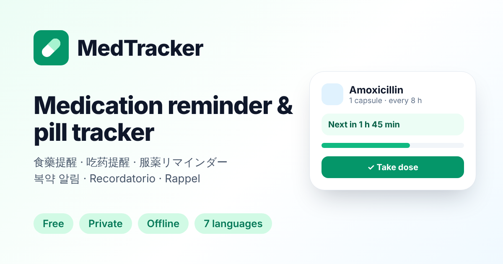

<div align="center">

</div>

# MedTracker

A free, private, multilingual medication reminder and pill tracker. It runs fully in the browser, works offline and can be installed as an app (PWA). No account and no server: data stays on the device.

## Features

- **Flexible schedules**: fixed times of day (e.g. 08:00 and 20:00), every X hours, or as needed with a minimum gap between doses.
- **One-tap dose logging** with undo, skip a dose, and an "are you sure?" prompt when a dose is taken early.
- **Dashboard**: today's progress, the next dose with a countdown, overdue, due and low-stock alerts, 7-day adherence.
- **Pill counting**: progress for a course (e.g. antibiotics), quantity left, days of supply left, low-stock warnings and refills.
- **Dose log editor**: fix times, mark doses as taken or skipped, add doses you forgot to log.
- **History**: 7- and 30-day charts (with a table view), adherence %, and a day-by-day log.
- **Doctor visits**: follow-up appointments (doctor, specialty, location, things to bring) with reminders 1 week, 1 day or 2 hours before, or at the time, and calendar export.
- **Notes for your doctor**: jot down symptoms, side effects, questions and requests as they happen, optionally linked to a medication. Anything not discussed carries over to the next visit.
- **Visit summary**: everything to discuss, points suggested from your records (missed doses, frequent as-needed use, refills, finished courses), a medication review since the last visit, and a things-to-bring list. Share or copy it in one tap; after the visit, record what the doctor said and book the next follow-up.
- **Reminders**: browser notifications while the app is open or installed, and recurring calendar reminders (`.ics`) for Google, Apple and Outlook Calendar.
- **Data tools**: backup and restore (JSON, including appointments and notes), share or copy the medication list, erase everything.
- **UX**: light, dark and system themes; mobile bottom navigation; keyboard and screen-reader friendly dialogs; reduced-motion support.
- **7 languages**: English, 繁體中文, 简体中文, 日本語, 한국어, Español, Français. The language is picked automatically from the browser and can be changed at any time.

Data saved by the previous version (`localStorage["medications"]`) is migrated automatically.

## SEO

`vite build` generates a static, fully translated page for every language:

```
dist/index.html          x-default (English content; the app still auto-detects the language)
dist/en/index.html
dist/zh-hant/index.html
dist/zh-hans/index.html
dist/ja/index.html  dist/ko/index.html  dist/es/index.html  dist/fr/index.html
dist/sitemap.xml         (with hreflang alternates)
dist/robots.txt
```

Each page has a localized title, description and keywords; a canonical link; `hreflang` alternates (including zh-HK, zh-TW and zh-CN); Open Graph and Twitter cards; JSON-LD (`WebApplication` + `FAQPage`); and crawlable content (features, FAQ, language links) that the app replaces once it loads.

Set the public URL so canonical, hreflang and sitemap URLs are absolute:

```
SITE_URL=https://your-domain.example npm run build
```

`APP_URL` is used when `SITE_URL` is not set. Without either, URLs are relative and `sitemap.xml` is skipped.

## Run locally

**Prerequisites:** Node.js 20+

```
npm install
npm run dev        # http://localhost:3000 (also try /zh-hant/, /ja/, …)
npm run lint       # type-check
npm run build      # production build in dist/
npm run preview    # serve the production build
```

Deploy `dist/` to any static host. The language folders contain their own `index.html`, so no rewrite rules are needed.

## Project structure

```
src/
  App.tsx                 app shell, navigation, actions
  types.ts                data model
  i18n/                   language config, provider, Intl formatting, locales/*.ts
  lib/                    scheduling maths, storage & migration, calendar export, notifications
  hooks/                  medication store, theme, reminders, install prompt
  components/             views, cards, dialogs, form, toasts
seo/plugin.ts             build-time SEO pages, sitemap and robots.txt
public/                   manifest, service worker, icons, social image
```

### Adding a language

1. Add it to `LANGUAGES` in `src/i18n/config.ts`.
2. Copy `src/i18n/locales/en.ts` to a new file typed as `Messages` and translate it (the type checker reports missing keys).
3. Register it in `src/i18n/locales/all.ts` and in the `loaders` map in `src/i18n/index.tsx`.

## Disclaimer

MedTracker is a personal reminder tool and does not provide medical advice. Always follow the instructions of your doctor or pharmacist.
